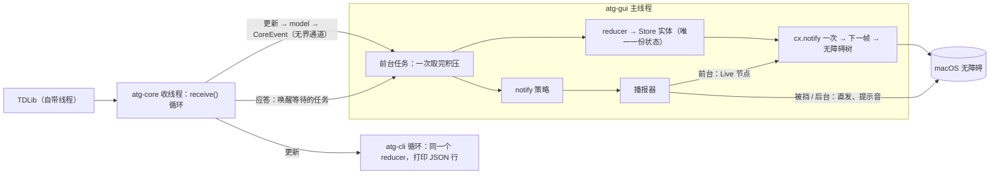

# 001 · arch · 接下来按什么结构写代码

> 2026-10-25 · 手下 arch 起草，已过三视角对抗评审一轮（核对员 / 老手挑刺 / 外行与规矩）与 codex 跨谱系评审一轮（`docs/reviews/002_arch-codex.md`），均已修完 · 状态：**草稿，末尾「待人拍板」未定**
> 依据：`docs/research/001_stack/decision.md`（4 条拍板，第 3 条 2026-10-25 改定）· `findings-gpui.md` · `findings-tg.md` · 实验 `docs/experiments/exp001`–`exp004`（exp003 含「后续 · exp003b」与「改向 · exp003b-v2」）
> 行号沿用调研时的版本：zed `79fe6a6` · accesskit_macos 0.26.3 · TDLib 1.8.69 · tdlib-rs 1.4.0。

## 〇、一句话

**`atg-core` 管数据和读法，不认识界面；`atg-cli` 和 `atg-gui` 是它的两个入口；无障碍薄壳只在 `atg-gui` 里，共五件：消息列表、播报器、树导出、焦点管理、输入框。**

### 术语（读到不懂回这里）

- **crate**：Rust 的一个模块包。本项目三个：`atg-core`、`atg-cli`、`atg-gui`
- **特征（trait）**：Rust 里的「接口」。这里用来让「真 Telegram」和「假数据」可以互换
- **收线程**：专门从 TDLib 收消息的那条后台线程
- **通道**：两条线程之间传东西的队列
- **reducer（归并函数）**：输入「旧状态 + 一件事」，输出「新状态」的纯函数；同样的输入永远得同样的结果，好测
- **虚拟化列表**：只把屏幕上看得见的几十项画出来、放进无障碍树，其余的不画；GPUI 里叫 `uniform_list` / `list`
- **active descendant**：列表整体拿着键盘焦点，再用一个属性告诉读屏「当前是哪一项」。VoiceOver 读那一项，焦点本身不离开列表
- **Live 节点**：一个不可见的状态元素，它的文字一变，读屏就念出来
- **直发公告**：应用直接请 macOS 念一句话，不经过界面元素
- **快照测试**：把输出存成文件，以后每次跑测试都和它比，变了就报出来让人看
- **夹具（fixture）**：测试用的、手写的假数据
- **CI**：每次推代码时 GitHub 自动跑的检查（格式、`clippy` 静态检查、测试）
- **前台 / 被挡住 / 后台**：本应用窗口在最前 / 被别的窗口盖住 / 用户切到了别的应用

---

## 一、三个模块

### 1. 依赖方向

文字版：`atg-cli` 依赖 `atg-core`；`atg-gui` 依赖 `atg-core` 和 GPUI；`atg-core` 依赖 tdlib-rs，tdlib-rs 再调 TDLib 的动态库。反方向一律不许。

- `atg-core` **不依赖 GPUI**，也不向外暴露 tdlib-rs 的类型（`findings-tg.md`「三个风险」第 3 条：库的类型别一路渗到界面）
- `atg-cli` 不依赖 GPUI：编得快，CI 和 AI 都能只靠它跑
- `atg-gui` 不直接调 tdlib-rs：要新能力，先加进 `atg-core`，`atg-cli` 先用上，再接界面（`.42cog/cog.md`「关键关系」第 1 条）

### 2. 各自职责

**`atg-core`**，七块：

1. `td`：起 TDLib、收线程、发请求、关闭流程（第 3 小节）
2. `model`：本项目自己的数据类型（会话、消息、发送人、附件……），由 tdlib-rs 类型映射而来。消息的正文字段直接用内容树的 `Content`（第 7 块），不另定义一种「格式化文本」
3. `store`：会话列表和「当前打开的消息窗口」的状态。**只是一个 reducer**，不自己开线程、不自己持锁；谁用谁在自己的线程上跑它（第 3 小节）
4. `speech`：读法，纯函数，内容树的渲染器之一（第三节）
5. `notify`：新消息提示的**策略**——计数、合并、什么时候说。纯逻辑，输入显式传进来，时钟可注入（第二节第 2 小节）
6. `Backend` 特征：只暴露本项目要的**意图级**操作（如「登录下一步」「拉会话」「拉某会话最近 N 条」「发到收藏夹」），不照抄 TDLib 的几百个函数。真实一份实现、假数据一份实现
7. `tree`：**内容树（AST）**——一切要被读出来或打印出来的东西（消息、系统消息、已撤回占位、会话项、新消息提醒、连接状态……）的唯一数据形状。读法、CLI 的 JSON、GUI、无障碍名称都是它的渲染器；**树只放数据，不放怎么读**；不认识的 TDLib 类型落带原类型名的「未知 / 泛化」节点，不崩。分两层：消息的「正文 + 附件」（`Content`）收到时建一次、存在 `model` 里；带名字、已读状态的整棵树（`Doc`）渲染时现投影，不存。规约 `specs/content-tree.md`；原型已在 `src/atg-core/src/tree/`

不管：任何界面、任何 macOS 调用、任何发声动作。

**`atg-cli`**：子命令 `login`、`chats`、`history`、`speech`（只打印读法）、`send`（须人当场确认）。输出 JSON，一行一条，给 AI 和脚本用。不自带业务判断，判断都在 `atg-core`。

**`atg-gui`**：GPUI 视图（登录、会话列表、消息、输入框）、键盘与焦点、无障碍薄壳 `a11y/`（第二节），以及把 `notify` 的决定变成真正的公告或提示音。读法字符串一律取 `atg-core::speech`，不自己拼。

### 3. 线程与事件流

**文字版流程**（下面的图是同一件事，给看图的人）：

1. TDLib 在自己的线程里联网、读写本地库
2. `atg-core::td` 的**收线程**循环调 tdlib-rs 的 `receive()`。收到的东西分两种：
   - 请求的**应答**：tdlib-rs 用一次性信道直接唤醒正在等它的那个异步任务（已核 `resources/tdlib-rs/tdlib-rs/src/lib.rs`、`observer.rs`：不要求特定执行器，放在 GPUI 前台执行器上能用）
   - **更新**（新消息、编辑、撤回、已读……）：收线程把它映射成 `model`，包成 `CoreEvent`，放进通道
3. **通道是无界的**。有界的话收线程一堵，所有请求的应答也跟着卡住。收线程给每条更新编一个递增的**序号**
4. **GUI**：主线程上一个前台任务等通道。**每批有上限**（条数和时间都设上限，比如最多几百条或几毫秒，具体数字原型里量），处理完一批就 `cx.notify()` 一次并**主动让出主线程**，让键盘、渲染和请求应答插得进来；还有积压就排到下一轮接着处理。大群刷屏、初始同步时，积压超过某个量就**合并**：每个会话只留最新的「最后一条 / 未读数」；当前打开的会话若积压太多，丢掉消息窗口、按第 6 条的规则重新拉一次历史
5. **请求的应答也进同一个 reducer**：等应答的任务同样跑在主线程，拿到后包成事件（如「历史已加载」）喂给 reducer。状态只有一份，在 GUI 的 `Store` 实体里；CLI 则在自己的循环里持一份
6. **合并规则**（应答和更新走两条路，到达顺序不保证，所以按下面的规则合并，结果与谁先到无关）：
   - **身份**：消息一律用 `(会话 id, 消息 id)` 标识。TDLib 的消息 id 只在所属会话内唯一（`td_api.tl:3551`），单用消息 id 会在切会话时撞车。store、墓碑、焦点锚点、界面元素 id 全都用这一对
   - **版本边界**：发历史请求时记下「当时最后一条更新的序号」和「请求代次」（每次切会话或重新拉历史，代次加一）。应答回来时：代次不是当前的，只更新那个会话的缓存，不动当前窗口；应答里某条消息，若在请求发出之后被任何更新碰过（撤回、改内容、改编辑时间……），**以 store 里的为准，跳过应答里的那份**。理由：发出之后才到的更新，要么和应答一样新，要么更新
   - **按字段合并**：内容只认 `updateMessageContent`（它不带时间；另有 `updateMessageEphemeralContent` 换有效内容、`updateMessageContentOpened` 改「已听 / 已看」，各改哪些字段见 `specs/content-tree.md` 第二节）；编辑时间只认 `updateMessageEdited`（它不带内容）。两条各管各的字段，**不拿编辑时间去比内容新旧**
   - **撤回留墓碑**：撤回过的 `(会话 id, 消息 id)` 不会被晚到的应答加回来
   - 单测专门造「旧历史应答」和「内容更新、撤回」交错到达的各种顺序（第四节）
7. 同一批事件也交给 `notify` 策略，策略说「现在提示」，播报器就照做：前台走 Live 节点（随下一帧进树），被挡住或在后台走直发公告和提示音（不等帧）

另外四条：

- **焦点按 `(会话 id, 消息 id)` 锚定，不按下标**。新消息追加、往上加载更早的历史、编辑、撤回，都只改 store；选中项的 id 不变，每帧按 id 重算下标。exp004 七种模式下新消息到达都没挪动选中项，正式代码要保持（真难题 1）
- **播报不能只靠重绘**：窗口被挡住或在后台时 GPUI 不出帧，Live 节点和无障碍树都会滞后；直发公告和提示音不受影响（`exp004-announce-calm/README.md`「⚠️ 风险」）
- **列表必须虚拟化**：新消息到树更新，50 项中位 21 ms、500 项 48 ms，几乎全在 GPUI 渲染，随渲染项数线性涨（`exp002-tdjson-latency/README.md`「四」第 2 条）。TDLib 那一段不到 1%：exp002 的 `td_bench` C 段走 tdlib-rs 的真实用法，往返中位 0.022–0.107 ms；`ui_bench` 是用后台线程扮演收线程
- **全进程只有一个 TDLib 收线程**：tdlib-rs 的 `receive()` 是全进程共用的，内部 `OBSERVER` 是全局单例（评审核过源码）。所以「真实后端」在一个进程里只能有一份；假后端不碰它

### 4. 启动与关闭

- **启动**：开窗和起 TDLib 并行。冷启动的大头在 GPUI 开窗和第一次建树（约 0.28 s），TDLib 自己约 20 ms，不在关键路径上（exp002「冷启动」）
- **初始同步**：启动或重连时，TDLib 会补发一大批积攒的更新。`store` 照常吃，但给 `notify` 一个「初始同步结束」标记，结束前不提示。用哪个 TDLib 信号作界线（例如连接状态变为就绪），第一刀开工时读源码再定
- **关闭**：先向 TDLib 发 `close`，等到 `authorizationStateClosed` 再退出进程，否则本地库可能坏
- **收线程出错**：tdlib-rs 的 `receive()` 里有几处 `unwrap`；而等应答用的一次性信道存在全局静态的 `OBSERVER` 里，收线程死了也不会释放，等待的请求会**永远挂着**（`tdlib-rs/src/lib.rs:23,65-68`）。所以 `atg-core::td` 自己加一层监督：
  - 收线程外面套一层看守，线程退出或崩溃时广播一个「故障」信号
  - 每个请求都同时等两样：应答、故障信号。哪个先到算哪个；故障先到就以错误返回
  - 故障之后拒绝新请求，告诉界面「连接已断」（T10），并记日志（不含内容，见第四节）
  - 关闭时也一样：等 `authorizationStateClosed` 设一个超时；超时或故障就记日志后退出，并在下次启动时提示「上次没有正常关闭」
  - 补丁里顺手把 `receive()` 里会崩的 `unwrap` 换成报错（拍板 2 已定自维护补丁）

---

## 二、无障碍薄壳（`atg-gui/src/a11y/`）

不 fork GPUI。五件组件。

### 1. 消息列表 `NavList`

拍板 3 改定（人原话见 `decision.md` 第 3 行）：消息列表是一个专门的控件，用 Tab 或 VO+←/→ 找到它，进入后 ↑/↓ 逐条浏览。exp003b-v2 已按这个交互做了一版，自测 45 步 0 失败（`exp003-list-nav/README.md`「改向 · exp003b-v2」）。

- **形状**：列表整体是 Tab 顺序里的一站；子项不各占一站（这是 AI 对原话的理解，exp003b-v2 照此实现，待人第三次试用确认）
- **选中**：列表持键盘焦点，选中项用 active descendant 指出（exp003 假设 1：1137 步全过）
- **跨屏**：虚拟化列表；按键时先把目标项滚进可见区再选中，同一帧生效（exp003：每帧最多渲染 12 项，按键到新帧约 14.5 ms）
- **按键**：↑/↓、Home/End、PageUp/PageDown、Cmd+↑/↓，由应用处理，两端夹紧（exp003 假设 4）。离开再回来，选中项保持（exp003b-v2）
- **VO+←/→ 落到列表**：VoiceOver 的「键盘焦点跟随 VO 光标」设置开着时，落到列表就把键盘焦点交给列表，直接按 ↑/↓ 即可；设置关着时要多按一次 Tab 或 VO+Shift+↓（exp003b-v2 局限 3，`人工试用.md` 第三次试用第 16 步）
- **绕过输入法**：GPUI 先把方向键交给输入法（`gpui_macos/src/window.rs:2633-2770`），中文输入法可能吞掉。在 AppKit 层装一个按键监视器：**Tab / Shift+Tab 任何时候都截；↑/↓ 等只在列表有焦点时截**，输入框里的方向键留给输入法选字和移光标（exp003b-v2 做法）。U.S. 输入法下开、关都过自测；**双拼会不会吞方向键还没测到**，等人做输入法对照
- **读什么**：每项名称取 `speech` 的简短读法；**不读「第几条共几条」**（人试听 exp003）。列表名默认「消息」
- **位置属性照设**：`aria_position_in_set` / `aria_size_of_set` VoiceOver 拿不到（accesskit_macos 没实现，exp003 结论 2），但导出的树里有，agent 读树用得上
- **稳定标识**：每项的元素 id = `(会话 id, 消息 id)`。普通元素的无障碍节点 id 由**从根到它的整条元素 id 路径**哈希而来（`gpui/src/element.rs:230-254`，在 `:431` 取用），所以不光这一项的 id 要稳，**它所有上层元素的 id 也都要稳**；切会话时列表本身的 id 要带上会话 id，免得新会话的项复用旧会话的节点身份。（初稿引的 `window/a11y.rs:331-339` 是「合成子节点」的 id 算法，只管 Live 节点那类合成节点，引错了，已改）
- **VO+←/→ 逐条走遍全部历史**：不追求。exp003b 接 VoiceOver 滚动动作的代码保留、默认关（exp003 README「改向 · exp003b-v2」「推荐」）

会话列表（T02）用同一个组件、同一套按键——「同一个操作在所有界面用同一个键」（`.42cog/real.md`「使用者现实」）。

### 2. 播报器 `Announcer`

一个入口：`announce(文本, 级别)`。新消息提示由 `notify` 策略决定什么时候调它。四条出路：

- **Live 节点**：一个状态角色的不可见节点，设 Live 和文字；同一句重复时换一个节点（不换就不念；换节点就是换合成子节点的键，id 由父节点 id 加键哈希而来，`window/a11y.rs:331-339`）。用在：应用在前台，且希望 agent 读树也看得到这句话（exp001 结论 1、3）
- **直发公告**：在主线程直接请 macOS 念，可用最低优先级 10。用在：窗口被挡、应用在后台，或要低优先级（exp001 结论 5；exp004 结论 1）
- **提示音**：只响一声，每次复制一份声音对象再播（exp004 模式 3、结论 8）
- **写进名称 / 提示语**：窗口标题、列表名称写上「N 条新消息，按 M 收听」；或写进选中项的提示语（VoiceOver 读完名称、停一下才念的那段）。不主动说，用户回来时自然听到（exp004 模式 6、7：GPUI 树层已确认写上；提示语到 macOS 那一层的映射只来自源码，没实测）

`notify` 策略的输入**显式**传进来，由 GUI 每次调用时给齐：

- 应用在前台 / 被挡 / 后台
- 当前打开的是哪个会话、选中的是哪一条
- 最后一次按键的时间（「停手后」要用；注意 VO 组合键到不了应用，exp004 结论 4）
- 会话是否静音、这条是不是自己发的（自己发的不提示）
- 初始同步结束没有

**暂定策略**（exp004 推荐，待人试听后定，见「待人拍板」第 3 条）：新消息到达 → 提示音 + 写进名称；停手后按「选中项字数 × 180 ms + 1 秒」估算朗读时长再说一句汇总；按 m 主动收听；被挡或后台走直发。

封装时要防两处：改 Live 时如果文字不空会多念一次（exp001 结论 4）；树导出里看不到 Live 字段（exp001 末段），所以 Live 节点要在树导出里另记一笔。

### 3. 树导出 `TreeDump`

服务两件事：`CLAUDE.md` 第五节「改了 `atg-gui` 必附无障碍树导出对比」，以及 agent 友好那把尺子。

- **激活**：在本进程里对窗口内容视图问一次子元素或焦点元素，AccessKit 就建树，**不需要辅助功能权限**（exp002 做法；exp003「其他实测到的事」）
- **导两层**：GPUI 层（`Window::debug_a11y_tree_json()`）和 macOS 层（逐个问角色、标题、提示、选中、焦点）。两层不一样：`ListItem` 在 macOS 层是「组」，位置属性在 macOS 层没有（exp003「角色映射」）。**VoiceOver 读的是 macOS 层**，所以两层都要
- **比对**：去掉每次都变的字段（几何位置、时间戳），按稳定 id 排序，存成文本快照；PR 里贴两次导出的差异
- **数据**：`atg-gui --fixture <名字> --dump-tree <路径>`，用假后端喂编好的会话和消息，不联网、不碰真实账号
- **限制**：GPUI 的测试平台不实现无障碍（`findings-gpui.md` 第 5 条），**只能开真窗口导**；macOS 层的焦点只在窗口是前台窗口时报（exp003「其他实测到的事」）。所以每次导出都是一次「弹窗、要前台」的运行，见「待人拍板」第 6 条

### 4. 焦点管理 `FocusManager`

- 管 Tab 顺序（exp003b-v2 已用 GPUI 的 `tab_index` / `tab_stop` 跑通一圈：标题 → 搜索 → 消息列表 → 输入 → 发送）
- 管「事后焦点落在哪」：切会话后、发送后、关掉对话框后、出错后。规则先列成表交人看，GUI 阶段再定
- 焦点只在用户按键时移动；新消息、更新、加载历史**一律不移动焦点**

### 5. 输入框 `Composer`

- 一个快捷键进输入框，回车发送，发送后读出「已发送」（T04）
- 焦点在这里时，方向键交还输入法和光标，按键监视器不截（见第 1 小节）
- 发送一律经 `atg-core` 的同一道闸（第四节第 1 小节）

---

## 三、读法放哪、怎么做快照对比

- **放在 `atg-core::speech`**，是内容树（第一节第 2 小节第 7 块）的渲染器之一。输入是**内容树**，不是 tdlib-rs 的类型，也不直接读 `model`；读法只管「这棵树怎么说成一句话」，树里有什么由投影决定
- **在渲染时算，不在收到消息时算**：`updateNewMessage` 里只有发送人 id，名字要查用户缓存，而用户信息可能比消息晚到；被回复的那条可能要另发请求取。所以树分两层：正文和附件只取决于消息本身，收到时建一次存进 `model`；发送人名字、回复谁、已读状态这一层每次渲染时按当时 store 里有什么现投影，再交给读法。查不到名字时树里留空，兜底说法（「未知用户」）归读法
- CLI 的 `speech` 子命令和 GUI 的列表读的是同一个函数、同一句话（`.42cog/cog.md`）；CLI 的 JSON 行是同一棵树的另一个渲染器，读法放在 JSON 外壳的 `speech` 字段里，不进树
- **加一种新节点**：树的枚举不加 `#[non_exhaustive]`，渲染器一律写不带 `_ =>` 的 `match`（clippy `wildcard_enum_match_arm` 拦），所以新节点一加，每个没处理它的渲染器都编不过；另有覆盖测试逼着为它补夹具，它就出现在所有快照里（`specs/content-tree.md` 第七节）
- **分层**（真难题 2）：
  - `brief`：列表里每项的名称，先读最要紧的。当前样子「发送人：内容，时间」，不读位置（exp003b「C」）
  - `detail`：按需展开——回复谁、转发自谁、已编辑、表情回应、按钮、已读（T06）
  - `chat_brief`：会话列表一项——名字、未读数、最后一条摘要，约 3 秒内读完（T02）
- **快照测试**：用 `insta`。输入是手写的 TDLib JSON 夹具（形状照 `updateNewMessage`，exp002 用过 1237 字节的样本），先解析、再建树、再读，**一次把建树和读法一起测住**；同一份夹具也出 JSON 行的快照。原型已跑通：`src/atg-core/tests/`（夹具 `fixtures/`，快照 `snapshots/`）。夹具里的人名和内容全是编的，**绝不从真实聊天截取**（`.42cog/real.md`「隐私」）
- **标准从哪来**：读法规约放 `specs/style/`，AI 起草正例和反例，人改。人改定的那一版就是快照的期望值（`.42cog/cog.md`「关键关系」）
- **PR 里怎么附**：改到读法的 PR，贴快照文件的差异。读法字符串也会出现在树导出里，所以界面的树快照会跟着变，一起贴

---

## 四、测试策略

### 1. 绝不碰真实联系人

- 联网测试一律走 **Telegram 测试服务器**（TDLib 一个参数 `use_test_dc`，`findings-tg.md` 第 5 行），发消息只发**收藏夹**
- 代码里一道闸：测试模式下发送只认收藏夹那个会话，别的直接拒绝
- **人工确认放在 `atg-core` 的发送入口，不放在 CLI 里**（`.42cog/intent.md`「AI 友好」：对外动作**无论走哪条路**都须人确认）。`atg-core` 的发送函数只收一张「确认凭据」，凭据绑定**发给谁 + 发什么**（内容的摘要值），目标或内容一变就作废；没有凭据不发。凭据只能由面向人的确认步骤开出：
  - CLI：在终端里把「发给谁、发什么」完整打出来，人按确认键（非交互环境下直接拒绝）
  - GUI：一个确认步骤，VoiceOver 能读出「发给谁、发什么」，人按确认键
  - 用 computer use 操作界面的 AI 也能按到那个确认键——怎么防，见「待人拍板」第 9 条
- **日志里不出现聊天内容**：tdlib-rs 遇到解析不了的更新时，会把整条原始 JSON 打进日志（`tdlib-rs/src/lib.rs:51`），里面可能有真实聊天内容（违反 `.42cog/real.md`「隐私」）。接真实账号之前，补丁里删掉这段原始内容，只记类型名；TDLib 自己的日志级别调低、日志文件放仓外；本项目自己的日志只记 id 和类型，不记内容。用一条「带敏感字段的未知更新」做测试，确认日志里没有它的内容
- 密钥只进 `.env.local`；TDLib 的本地库目录放仓外（如 `~/Library/Application Support/atg/`），永不入库
- CI 不连真实账号；测试服务器的联网测试默认也不在 CI 里跑（`specs/workflow.md` 第 9 节）

### 2. 谁来判

**机器 · CI**（每次推代码自动跑）：

- `cargo fmt --check`、`clippy -D warnings`、`cargo test`
- `model` 映射
- reducer：新消息进来选中项不变；往上加载历史后下标重算；**旧历史应答与内容更新、撤回交错到达的各种顺序，结果都一样**；两个会话里消息 id 相同时不串；过期代次的应答不动当前窗口
- 收线程监督：模拟收线程崩溃，所有等待中的请求以错误返回，之后的新请求被拒
- 发送闸：没有凭据、凭据与目标或内容不符，一律不发
- 日志：带敏感字段的未知更新，内容不进日志
- `notify` 策略：用假时钟；初始同步期间不提示；自己发的不提示
- `speech` 快照
- CLI 对假后端的集成测试
- 只编 `atg-core` 和 `atg-cli` 时不用拉 GPUI

**机器 · 本机 · 要联网**（人同意后跑）：测试服务器登录、拉会话、往收藏夹发一条再收到；顺带量「冷启动到第一条会话可读」和「收藏夹消息端到端延迟」（exp002「测不了的部分」头两行）。

**机器 · 本机 · 要弹窗**（须经人同意，会抢前台）：树导出与比对；`NavList` 自测（照 exp003b-v2 的 `selftest-tab`：AppKit 真实按键事件）。

**AI 判据**：读法对照 `specs/style/` 的正例和反例审。

**人**：VoiceOver 实际开没开口、打没打断朗读、提示音听感、「组 / 文本」这些叫法、读法顺不顺；按 `specs/tasks.md` 逐项走。

机器只能证明「发出了什么、什么优先级、什么时候」；**VoiceOver 实际说了什么，进程内观测不到**（exp001 结论 6、exp003「没验证到的」、exp004「结论」开头）。这一截就是验证红线。

---

## 五、已知风险与未决项

- **R1 礼貌式公告也会插进正在读的内容。** 出处：`exp001-announce/README.md`「人工试听」。处理：改用 exp004 的组合，等人试听 exp004
- **R2 窗口被挡或在后台时 GPUI 不出帧，Live 节点和无障碍树都滞后。** 出处：`exp004-announce-calm/README.md`「⚠️ 风险」。处理：提示走直发和提示音；树滞后本身没有便宜绕法，属于上游 GPUI 的范围
- **R3 中文输入法可能吞方向键。** 出处：`exp003-list-nav/README.md`「后续 · exp003b · A」与「改向 · exp003b-v2」。现状：绕法已在 U.S. 输入法下自测通过（45 步 0 失败）；双拼没测到，VoiceOver 开着时按键到不到也只能人试。长远给 GPUI 提 PR：没有文本框获焦时不把方向键交给输入法
- **R4 VO 落到列表后能否直接用 ↑/↓，取决于用户的 VoiceOver 设置**（「键盘焦点跟随 VO 光标」）。出处：exp003b-v2 局限 3。处理：第三次试用第 16 步听；不行就在列表名或提示语里说明「按 VO+Shift+↓ 进入」，由人定
- **R5 「第几项共几项」交不到 VoiceOver。** 出处：exp003 结论 2。处理：人定不读；以后可给 accesskit 提 PR（exp003 方案 C）
- **R6 树只在辅助技术激活后才建；GPUI 测试平台拿不到树。** 出处：`findings-gpui.md` 第 5 条。处理：进程内激活 + 真窗口导出；CI 里做不了
- **R7 GPUI 无障碍接口半年内连续改动。** 出处：`findings-gpui.md`「三个风险」第 1 条。处理：锁 commit；升级后必须重新导树比对（`.42cog/cog.md`）
- **R8 tdlib-rs 落后上游、单人维护；补丁要同时改 `tl/api.tl` 和写死的库文件名。** 出处：`decision.md` 第 2 行；`findings-tg.md` 第 6 行。处理：拍板 2 = 自维护补丁，单独一件事；第一刀先用哪版见「待人拍板」第 5 条
- **R9 速度数字都是 debug 上界；「冷启动到会话列表可读」没量过；有一次冷启动 0.74 s 原因不明。** 出处：`exp002-tdjson-latency/README.md`「冷启动」「测不了的部分」。处理：第一刀第 5 条顺手量
- **R10 消息高度不一。** `uniform_list` 要求每项等高。`list` 的屏外多渲染那一段：codex 评审读了 `gpui/src/elements/list.rs:1087-1117`，屏外项会被量尺寸，但只有可见项进入要画的那份清单，所以**不能指望屏外项进树**（与 `state/handoff/exp003b.md` 的说法一致；`findings-gpui.md` 第 3 条的「多渲染一段」不准确）。处理：原型先用等高单行；多行消息到 GUI 阶段再定，换 `list` 也照样靠「先滚再选」
- **R13 依赖自己的日志可能泄露聊天内容。** 出处：`tdlib-rs/src/lib.rs:51`。处理：第四节第 1 小节，接真实账号前必须先改
- **R14 会话列表的离线首屏没验证过。** `only_local` 只属于 `getChatHistory`（`td_api.tl:12758`），`getChats` / `loadChats` 都没有这个参数（`td_api.tl:12502,12507`）。会话列表要用 `loadChats` 加载，再靠 `updateNewChat` / `updateChatPosition` 等更新维护顺序；`loadChats` 会不会先从本地库出结果，没核过。处理：第一刀第 5 块里量
- **R11 启动、重连时补发的大批更新可能被当成新消息。** 出处：老手评审。处理：`notify` 的「初始同步结束」标记（第一节第 4 小节），具体信号开工时核
- **R12 提示语（`aria_description`）只有一个位置，「新消息提示」（exp004 模式 7）和读法的「详情提示」都想用。** 处理：见「待人拍板」第 3 条

---

## 六、第三步「系统原型」第一刀：`atg-cli` 登录 + 列会话 + 读法定标

**只列拆法，不开 issue，也不替人写 issue。** 按 `specs/workflow.md` 第 2 节，功能和读法标准都是意图类 issue，由人写；下面每条只说「这一块管什么」，供人写 issue 时参考。每块估计都在 3 天以内，且能单独验证。

1. **建两个 crate**：`src/atg-core`、`src/atg-cli` 空骨架，CI 通过；`.42cog/cog.md` 实体表里「还没建」那句跟着改。单独验证：`cargo test` 过，CI 不拉 GPUI。**现状（2026-10-25）**：`atg-core` 已由内容树原型建出（含 `tree`、`speech`、`json` 和临时的夹具输入 `tdjson`，35 个测试、clippy、fmt 本机全过）；`atg-cli` 还没建
2. **model + reducer**：会话、消息等数据类型；reducer 吃事件出新状态（含会话排序、`(会话 id, 消息 id)` 身份、撤回墓碑、按字段合并、版本边界与请求代次）。消息正文字段用内容树的 `Content`；另写一个纯函数「model + store → 内容树 `Doc`」（投影），把原型里 `tdjson::World::docs()` 的做法搬过来。单独验证：全用假事件单测，不需要 TDLib
3. **接 TDLib**：收线程（带序号）、`CoreEvent` 通道、关闭流程、收线程监督与故障广播；日志不含内容（含 tdlib-rs `lib.rs:51` 那段）；发送入口的确认凭据；`Backend` 特征两份实现；读 `.env.local`；本地库目录在仓外；`use_test_dc` 开关。单独验证：假后端单测；本机对测试服务器能拿到第一条授权状态更新
4. **`atg-cli login`（T01）**：手机号 → 验证码 → 二步验证密码（含邮箱那一支），出错时打印原因。单独验证：测试服务器上登录成功，输错验证码时原因可读
5. **`atg-cli chats`（T02 的数据部分）**：用 `loadChats` 加载、靠会话更新维护排序（`only_local` 只用于消息历史，不用于会话列表）；顺带验证断网时会话列表能不能先从本地库出来；每行一个 JSON：id、名字、未读数、最后一条摘要、`chat_brief` 读法；打印冷启动到第一条会话的耗时。单独验证：测试服务器账号上列得出，耗时有数字
6. **speech v0 + 快照测试**：`brief` 和 `chat_brief`；手写夹具；`atg-cli speech --fixture`。单独验证：快照入库，CI 跑快照。**现状**：内容树原型已做了 `brief`、`chat_brief`、新消息提醒的读法和两份夹具的快照（说法是 AI 草稿）；剩下的是接 `atg-cli speech --fixture`，以及第 2 块做好后把输入从夹具换成投影
7. **读法规约 v0（定标）**：AI 在 `specs/style/` 起草会话一项、消息一项的正例与反例，**人改**；人改定后回填第 6 块的快照期望值
8. （可选）**`atg-cli history`（T03 的数据部分）**：只读某会话最新 N 条，每条带 `brief`。单独验证：测试服务器上读得出收藏夹

顺序：1 → 2 → 3 → 4；6 在 2 之后就能并行；5 要等 2、3；7 跟在 6 后面；8 最后。
另有一件已在 `state/coord.md`「Top 3」里的事：tdlib-rs 补丁（编 TDLib 1.8.69）。它和第 3 块的关系见「待人拍板」第 5 条。

---

## 七、⚠️ 待人拍板

AI 不代填。每条都写了选项、代价和建议，不用翻别的文件也能选。

**✅ 人已拍板（2026-10-25，问答选定）**

| # | 事项 | 人选 |
|---|---|---|
| 1 | 列表角色 | 普通列表（列表 / 列表项） |
| 2 | 进入列表读不读条数 | 只读「消息」 |
| 3 | 新消息提示 | 先按建议组合：③ 提示音 + ⑥ 写进标题和列表名 + ⑤ 估算读完再说汇总 + 按 m 收听；提示语那一格给读法「详情」（B）；试听后可改 |
| 4 | 后台提醒 | **直接用系统通知**（macOS 通知中心，需申请通知权限）——未取建议 A |
| 5 | 第一刀 TDLib 版本 | **等 1.8.69 补丁做完再开第一刀**（B）——未取建议 A；拍板 2 照原样执行 |
| 6 | 树导出弹窗许可 | 长期许可：**随时可跑，每次不超过 1 分钟，人关窗即停** |
| 7 | 选中项被撤回 / 编辑 | 原位留「已撤回」占位（焦点不动） |
| 8 | 本地库加密 | 加密，密钥放钥匙串 |
| 9 | AI 经界面发送 | 要 Touch ID / 系统密码（至少对收藏夹以外的会话） |
| 10 | 测试发收藏夹 | 只「测试服务器 + 收藏夹」免确认，写死在发送闸并有单测 |
| 11 | **直发模式**（2026-10-25 追加，人原话：「对如果要ai发消息，我觉得可以专门verbose 或者说有一个类似 claudecode 的方式 / 如果说我用这种方式进入就完全免确认，直接发 / 这个比较好」） | 加一个启动参数即进入；**所有会话**免确认直接发；**到程序退出为止**。不进入时第 9、10 条照旧。人已知风险：AI 自己也能加这个参数；收到的消息里藏的指令可能诱导 AI 发错。测试仍绝不向真实联系人发消息（`CLAUDE.md` 第五节） |

**1. 消息列表在 VoiceOver 里算什么角色**

- A. 普通列表（列表 / 列表项）：每一项 VoiceOver 读成「组」
- B. 列表框（列表框 / 选项）：每一项读成「文本」，列表还会多报「行数」「已选项」——但只数看得见的十几项，可能误导
- 建议：原型先用 A。要比较的话，exp003 `人工试用.md` 里有现成的「可选第三轮：列表框角色」（`./run.sh --listbox`），听一遍就能定；第三次试用里没有这个对照

**2. 进入列表时，列表名读不读总条数**

- A. 只读「消息」
- B. 读「消息，共 N 条」，只在进入列表那一刻读一次
- 注意：这和已经否决的「每条都读第几条共几条」是两回事，这里每条消息本身都不读位置
- 建议：A（你说过不要「共几条」，这是最强的信号）。想比较可在第三次试用时跑 `./run.sh --list-count`

**3. 新消息来了怎么提示；提示语那一格给谁用**

exp004 试过七种：① 礼貌式立刻说（会插进朗读，已知不行）② 最低优先级立刻说 ③ 只响一声 ④ 停手 3 秒后说汇总 ⑤ 按当前这条的朗读时长估算、读完再说汇总 ⑥ 写进窗口标题和列表名，不说 ⑦ 写进当前这条的提示语，不说。

- 建议组合：③ + ⑥ + ⑤，再加「按 m 主动收听」；② 如果你试听确认它会排在朗读之后，可以代替 ⑤，实现更简单
- 提示语那一格：A. 给新消息提示（⑦）　B. 留给读法的「详情」提示（如「按 D 听详情」）。建议 B，新消息靠 ⑥ 已经能听到
- 定之前需要你按 exp004 `人工试用.md` 试一遍

**4. 应用在后台时怎么提醒**

- A. 直发公告：不用申请权限；但 VoiceOver 在你用别的应用时会不会念它，还不知道
- B. 系统通知（macOS 通知中心横幅，VoiceOver 会读）：要申请通知权限，横幅也会出现在屏幕上
- 建议：先试 A（exp004 `人工试用.md` 第 11 步：按 l 后切到别的应用，听有没有提醒）；听不到再上 B

**5. 第一刀用哪版 TDLib**

- A. 先用 tdlib-rs 自带的 1.8.61 预编译库跑通第一刀，补丁并行做。⚠️ 这等于**暂缓**你已定的拍板 2（自维护补丁、用 1.8.69）——不是推翻，补丁做好后再切
- B. 等 1.8.69 补丁做完再开第一刀：路线干净，但第一刀要排在补丁后面，还要一次编译 TDLib 的名额（几十分钟）
- 建议：A。`.42cog/meta.md`「依赖」已写「实验用 1.8.61 预编译、正式用自编 1.8.69」，第一刀属于原型

**6. 树导出要弹窗口、要前台，以后每个改界面的 PR 都要跑一次**

- A. 每次单独问你：最稳，但 GUI 阶段每个 PR 都会停下来等你
- B. 给一条长期许可，边界由你写，例如「只在我说『可以弹窗』之后的那一段时间里跑」「每次不超过一分钟」「你关窗我就停」
- 建议：B，边界由你定

**7. 你正停在某条消息上，它被撤回或被编辑了**

- 焦点移到哪（上一条 / 下一条 / 原位留一个「已撤回」占位），说不说一句
- 建议：GUI 阶段再定；`store` 先保证不崩、不乱跳

**8. TDLib 的本地库要不要加密**

- A. 不加密：简单；但别人拿到这台 Mac 的文件，就能读到全部聊天缓存
- B. 加密，密钥放 macOS 钥匙串：多一步启动时取密钥的代码，钥匙串可能弹授权框
- 建议：B。涉及账号安全，按 `specs/workflow.md` 第 6 节算「一级评审」：除了另一家模型评审，还要你本人看过

**9. 用 computer use 操作界面的 AI，能不能替你按「确认发送」**

发送确认放在 `atg-core` 的入口（第四节第 1 小节）。但 AI 读无障碍树操作界面时，确认键对它和对你一样可按。

- A. 不额外防：把「AI 经界面发送」视为你在旁边看着、由你负责
- B. 确认要一样 AI 拿不到的东西：比如 Touch ID / 系统密码弹框（macOS 本地认证），每次发送都要
- C. 确认键不进无障碍树、只认物理键盘的某个组合键：⚠️ 这会让语音控制、切换控制这些辅助功能也按不到，和「一律走系统无障碍接口」相冲突
- 建议：B，至少对「发给收藏夹以外的会话」要求 B

**10. 测试时发往收藏夹，要不要每次人工确认**

- A. 要：最严，但自动化测试跑不起来（每条都要人按）
- B. 只在「测试服务器 + 收藏夹」这一种组合下免确认，其他一律要确认
- 建议：B。代码里把这条豁免写死在发送闸里，并有单测确认别的组合不免

---

## 修订记录

- 2026-10-25 · 手下 tree：把内容树（AST）写进来——第一节第 2 小节 `atg-core` 由六块改七块（加 `tree`，`model` 正文用 `Content`，`speech` 是渲染器）；第三节前三条改为「读法的输入是内容树、树分存的与现算的两层」，加「加新节点怎么提醒」一条，快照测试一条补原型位置；第六节第 1、2、6 块补现状与投影函数；第一节第 3 小节「按字段合并」补两种也会改内容的更新。第七节未动
